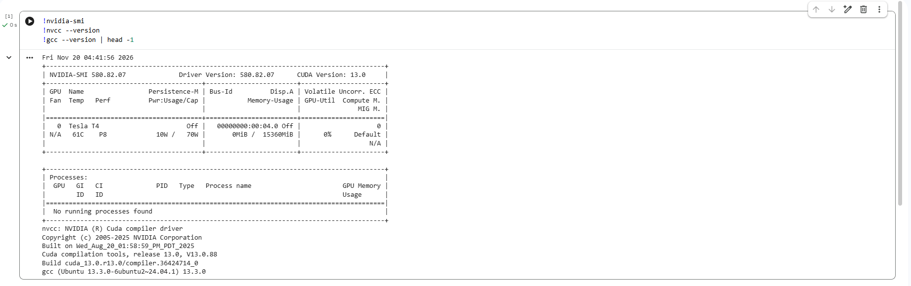
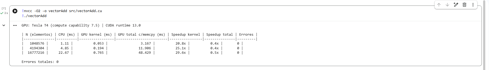
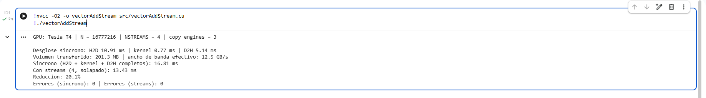
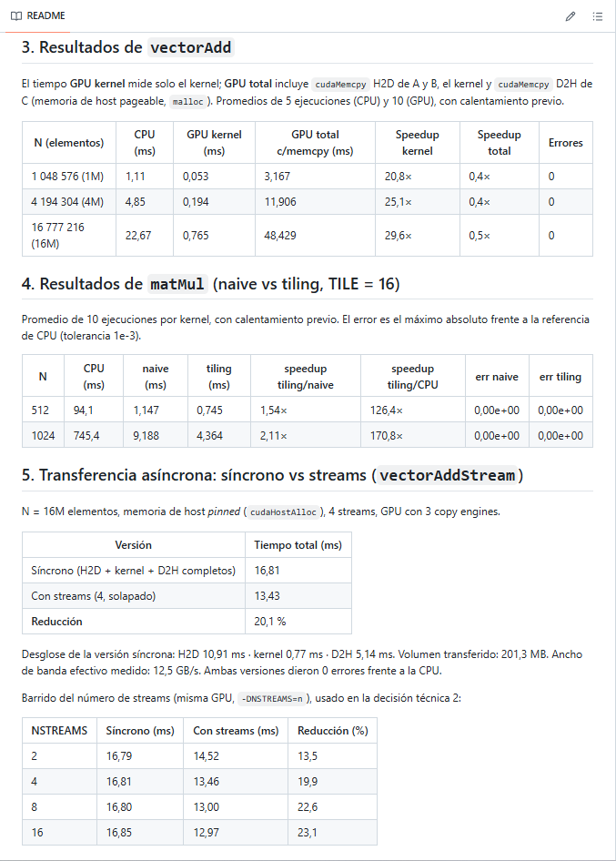

# Post-Contenido — Benchmark CUDA (CPU vs GPU) y análisis comparativo de aceleradores de IA

Arquitectura de Computadores — Unidad 11 · UFPS

Repositorio único para las dos partes del laboratorio:

- **Parte 1:** tres programas CUDA en C (`vectorAdd`, `matMul` con tiling en shared memory y `vectorAddStream` con transferencia asíncrona) medidos con `cudaEvent`.
- **Parte 2:** análisis técnico comparativo de GPU, TPU, NPU y FPGA para IA en [`docs/analisis-comparativo.md`](docs/analisis-comparativo.md).

```
Alferez-post11-u11/
├── README.md
├── src/
│   ├── vectorAdd.cu          # suma de vectores, CPU vs GPU
│   ├── matMul.cu             # multiplicación de matrices: naive vs tiling
│   └── vectorAddStream.cu    # síncrono vs streams + cudaMemcpyAsync
├── capturas/                 # capturas de los checkpoints
└── docs/
    └── analisis-comparativo.md
```

## 1. Descripción del entorno

| Elemento | Valor |
|---|---|
| GPU (`nvidia-smi`) | Tesla T4, 15 360 MiB (compute capability 7.5) |
| Driver | 580.82.07 |
| CUDA Toolkit (`nvcc --version`) | 13.0 (nvcc V13.0.88). La guía pide 12.x; el código compila igual en 13.0 |
| Sistema operativo | Ubuntu 24.04 (imagen de Google Colab) |
| Plataforma | Google Colab con GPU T4 |
| Compilador host (`gcc --version`) | gcc 13.3.0 (Ubuntu 13.3.0-6ubuntu2~24.04.1) |

## 2. Compilación y ejecución

```bash
nvcc -O2 -o vectorAdd src/vectorAdd.cu
./vectorAdd

nvcc -O2 -o matMul src/matMul.cu
./matMul

nvcc -O2 -o vectorAddStream src/vectorAddStream.cu
./vectorAddStream

# Variante con otro número de streams (para la decisión técnica 2)
nvcc -O2 -DNSTREAMS=8 -o vectorAddStream src/vectorAddStream.cu
```

Flags: `-O2` optimiza el código del host (incluida la referencia de CPU). No se fija `-arch`, así que `nvcc` usa su arquitectura por defecto y el driver compila el PTX para la GPU presente; en una GPU concreta se puede añadir, por ejemplo, `-arch=sm_75` (T4).

Los tres programas calientan la GPU antes de medir, promedian varias repeticiones, miden con `cudaEvent`, verifican el resultado contra la CPU y revisan cada llamada CUDA con `CUDA_CHECK` / `cudaGetLastError()`.

## 3. Resultados de `vectorAdd`

El tiempo **GPU kernel** mide solo el kernel; **GPU total** incluye `cudaMemcpy` H2D de A y B, el kernel y `cudaMemcpy` D2H de C (memoria de host pageable, `malloc`). Promedios de 5 ejecuciones (CPU) y 10 (GPU), con calentamiento previo.

| N (elementos) | CPU (ms) | GPU kernel (ms) | GPU total c/memcpy (ms) | Speedup kernel | Speedup total | Errores |
|---------------|----------|-----------------|-------------------------|----------------|---------------|---------|
| 1 048 576 (1M) | 1,11 | 0,053 | 3,167 | 20,8× | 0,4× | 0 |
| 4 194 304 (4M) | 4,85 | 0,194 | 11,906 | 25,1× | 0,4× | 0 |
| 16 777 216 (16M) | 22,67 | 0,765 | 48,429 | 29,6× | 0,5× | 0 |

## 4. Resultados de `matMul` (naive vs tiling, TILE = 16)

Promedio de 10 ejecuciones por kernel, con calentamiento previo. El error es el máximo absoluto frente a la referencia de CPU (tolerancia 1e-3).

|   N   | CPU (ms) | naive (ms) | tiling (ms) | speedup tiling/naive | speedup tiling/CPU | err naive | err tiling |
|-------|----------|------------|-------------|----------------------|--------------------|-----------|------------|
| 512   | 94,1 | 1,147 | 0,745 | 1,54× | 126,4× | 0,00e+00 | 0,00e+00 |
| 1024  | 745,4 | 9,188 | 4,364 | 2,11× | 170,8× | 0,00e+00 | 0,00e+00 |

## 5. Transferencia asíncrona: síncrono vs streams (`vectorAddStream`)

N = 16M elementos, memoria de host *pinned* (`cudaHostAlloc`), 4 streams, GPU con 3 copy engines.

| Versión | Tiempo total (ms) |
|---|---|
| Síncrono (H2D + kernel + D2H completos) | 16,81 |
| Con streams (4, solapado) | 13,43 |
| **Reducción** | 20,1 % |

Desglose de la versión síncrona: H2D 10,91 ms · kernel 0,77 ms · D2H 5,14 ms. Volumen transferido: 201,3 MB. Ancho de banda efectivo medido: 12,5 GB/s. Ambas versiones dieron 0 errores frente a la CPU.

Barrido del número de streams (misma GPU, `-DNSTREAMS=n`), usado en la decisión técnica 2:

| NSTREAMS | Síncrono (ms) | Con streams (ms) | Reducción (%) |
|---|---|---|---|
| 2 | 16,79 | 14,52 | 13,5 |
| 4 | 16,81 | 13,46 | 19,9 |
| 8 | 16,80 | 13,00 | 22,6 |
| 16 | 16,85 | 12,97 | 23,1 |

## 6. Análisis de resultados

**Por qué la GPU gana para N grande.** `vectorAdd` es una operación elemento a elemento sin dependencias: cada uno de los N elementos se asigna a un thread, y la GPU ejecuta miles de threads en paralelo, mientras que la referencia de CPU recorre el arreglo en un solo hilo. Además, la operación está limitada por memoria (una suma por cada 12 bytes movidos), y la memoria de la GPU (GDDR6 en la T4) ofrece un ancho de banda mucho mayor que la DRAM del host. Al crecer N, el costo fijo de lanzar el kernel (microsegundos) se amortiza: el speedup del kernel pasó de 20,8× con N = 1M a 25,1× con 4M y 29,6× con 16M, y tiende a estabilizarse en torno al cociente de anchos de banda de memoria. En `matMul` la ventaja frente a la CPU es todavía mayor (126× y 171×) porque el cómputo es O(N³) sobre datos O(N²): hay mucha aritmética por byte.

**Por qué el tiempo total pierde frente a la CPU.** El tiempo "GPU total" incluye mover 3·N·4 bytes por el bus PCIe, y `vectorAdd` hace muy poco cómputo por byte, así que la transferencia domina. En nuestras mediciones el tiempo total de la GPU fue mayor que el de la CPU en los tres tamaños (speedup total de 0,4× con 1M y 0,5× con 16M, a pesar de que el kernel solo es 20–30 veces más rápido): para N = 16M el kernel dura 0,77 ms, pero las copias llevan el total a 48,4 ms frente a 22,7 ms de la CPU. Además, esas copias usan memoria pageable (`malloc`): el driver debe pasar los datos por un buffer pinned intermedio, y el ancho de banda efectivo cae a unos 4,2 GB/s (201,3 MB en ≈ 47,7 ms), frente a 12,5 GB/s con memoria pinned en `vectorAddStream`, cuyo total síncrono es de 16,8 ms. Para que la GPU gane en `vectorAdd` habría que evitar la transferencia (datos que ya residen en la GPU, por ejemplo) o encadenar más operaciones sobre ellos.

**Efecto del tiling.** La versión naive lee de memoria global N veces cada elemento de A y de B; con tiling de 16×16 cada bloque carga un tile a shared memory una vez y lo reutiliza 16 veces, reduciendo por un factor 16 los accesos a memoria global (la shared memory está en el chip y tiene mucha menor latencia). El speedup tiling/naive medido fue de 1,54× con N = 512 y 2,11× con N = 1024, bastante menor que el factor teórico de 16: la caché L2 de la GPU ya absorbe parte de las lecturas repetidas de la versión naive, y la ventaja del tiling crece con N a medida que las matrices dejan de caber en caché.

## 7. Decisiones técnicas (Parte 1)

### 7.1 ¿`cudaMemcpyAsync` con streams o transferencia síncrona para `vectorAdd`?

Con N = 16M, `vectorAdd` mueve dos arreglos de entrada de 64 MiB y uno de salida de 64 MiB: 192 MiB (≈ 201 MB) entre host y device. Con un ancho de banda efectivo de PCIe de 10–12 GB/s (el teórico baja por la sobrecarga del protocolo), esa transferencia toma aproximadamente 16–19 ms; en nuestra GPU se midieron 12,5 GB/s y 16,05 ms (10,91 ms de H2D más 5,14 ms de D2H), frente a solo 0,77 ms del kernel: la transferencia es unas 20 veces mayor, por lo que `vectorAdd` es claramente *memory-bound* (una suma por cada 12 bytes movidos). Los streams no eliminan la transferencia, solo la solapan con el cómputo, así que con un solo copy engine el ahorro máximo teórico está acotado por la porción menor, el cómputo: como mucho 0,77 ms de 16,81 ms, apenas ≈ 4,6 %. La reducción medida fue de 20,1 %, mayor que esa cota, porque la T4 expone 3 copy engines y puede solapar H2D con D2H en sentidos opuestos, además de con el kernel. Conclusión: para `vectorAdd` el beneficio absoluto es pequeño (3,4 ms) y exige memoria pinned, chunks y sincronización; se justifica solo si la transferencia es inevitable. El solapamiento rinde mucho más en `matMulTiled`, donde el cómputo por chunk crece como O(N³) frente al O(N²) de datos transferidos y puede igualar o superar el tiempo de copia, de modo que oculta una fracción real del tiempo total.

### 7.2 ¿Cuántos streams usar y qué limita la ganancia?

Pasar de NSTREAMS = 4 a 16 con N = 16M fijo no reduce el tiempo de forma proporcional: en nuestro barrido la reducción fue de 13,5 % con 2 streams, 19,9 % con 4, 22,6 % con 8 y 23,1 % con 16, es decir, cuadruplicar los streams de 4 a 16 añade solo ≈ 3 puntos, y de 8 a 16 apenas 0,5. La razón es que todos los streams comparten los mismos recursos físicos, el bus PCIe y los copy engines (DMA): agregar streams no crea más ancho de banda ni más motores de copia, solo divide la misma transferencia en trozos más pequeños, con más sobrecarga de lanzamiento por stream. La mayoría de las GPUs NVIDIA modernas exponen 1 o 2 copy engines (la T4 usada reporta `asyncEngineCount` = 3); con uno solo, las copias se serializan entre sí y solo pueden solaparse con el cómputo, y con más, también se solapan H2D y D2H. El límite inferior lo fija el sentido más cargado: la H2D mueve 134 MB y tardó 10,91 ms en la versión síncrona, de modo que ningún número de streams baja el total de ≈ 11 ms; con 16 streams se llegó a 12,97 ms. Por eso un número pequeño de streams (2 a 4) captura la mayor parte de la ganancia. Dividir en más streams no reduce el tiempo total de transferencia, que sigue acotado por el ancho de banda del bus, un recurso compartido; solo reorganiza cuándo se mueve cada porción de datos para solaparla mejor con el cómputo.

## 8. Capturas de los checkpoints

| # | Archivo | Contenido |
|---|---|---|
| 1 | `capturas/01-entorno.png` | `nvidia-smi` y `nvcc --version` |
| 2 | `capturas/02-vectorAdd.png` | Checkpoint 1: salida de `vectorAdd` con tiempos CPU/GPU y 0 errores |
| 3 | `capturas/03-matMul.png` | Checkpoint 2: salida de `matMul` (naive vs tiling) |
| 4 | `capturas/04-vectorAddStream.png` | Checkpoint 4: síncrono vs streams |
| 5 | `capturas/05-streams-barrido.png` | Checkpoint 5: barrido de `NSTREAMS` |
| 6 | `capturas/06-readme-github.png` | Checkpoint 3: README completo publicado en GitHub |








## 9. Parte 2

El análisis comparativo de GPU, TPU, NPU y FPGA (caracterización, MLPerf, TCO, recomendación por perfil, cuantización INT8 y dos decisiones técnicas) está en [`docs/analisis-comparativo.md`](docs/analisis-comparativo.md).
