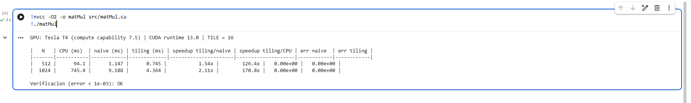
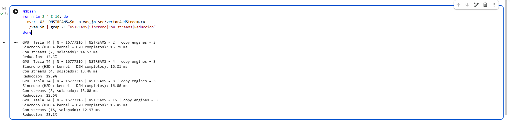

# Post-Contenido — Benchmark CUDA (CPU vs GPU) y análisis comparativo de aceleradores de IA

Arquitectura de Computadores — Unidad 11 · UFPS

Repositorio único para las dos partes del laboratorio:

- **Parte 1:** tres programas CUDA en C (`vectorAdd`, `matMul` con tiling en shared memory y `vectorAddStream` con transferencia asíncrona) medidos con `cudaEvent`.
- **Parte 2:** análisis técnico comparativo de GPU, TPU, NPU y FPGA para IA en [`docs/analisis-comparativo.md`](docs/analisis-comparativo.md).

```
Alferez-post11-u11/
├── README.md
├── src/
│   ├── vectorAdd.cu          # suma de vectores, CPU vs GPU
│   ├── matMul.cu             # multiplicación de matrices: naive vs tiling
│   └── vectorAddStream.cu    # síncrono vs streams + cudaMemcpyAsync
├── capturas/                 # capturas de los checkpoints
└── docs/
    └── analisis-comparativo.md
```

## 1. Descripción del entorno

| Elemento | Valor |
|---|---|
| GPU (`nvidia-smi`) | TODO |
| Driver | TODO |
| CUDA Toolkit (`nvcc --version`) | TODO |
| Sistema operativo | TODO |
| Plataforma | TODO (Google Colab con GPU T4 / equipo local) |
| Compilador host (`gcc --version`) | TODO |

## 2. Compilación y ejecución

```bash
nvcc -O2 -o vectorAdd src/vectorAdd.cu
./vectorAdd

nvcc -O2 -o matMul src/matMul.cu
./matMul

nvcc -O2 -o vectorAddStream src/vectorAddStream.cu
./vectorAddStream

# Variante con otro número de streams (para la decisión técnica 2)
nvcc -O2 -DNSTREAMS=8 -o vectorAddStream src/vectorAddStream.cu
```

Flags: `-O2` optimiza el código del host (incluida la referencia de CPU). No se fija `-arch`, así que `nvcc` usa su arquitectura por defecto y el driver compila el PTX para la GPU presente; en una GPU concreta se puede añadir, por ejemplo, `-arch=sm_75` (T4).

Los tres programas calientan la GPU antes de medir, promedian varias repeticiones, miden con `cudaEvent`, verifican el resultado contra la CPU y revisan cada llamada CUDA con `CUDA_CHECK` / `cudaGetLastError()`.

## 3. Resultados de `vectorAdd`

El tiempo **GPU kernel** mide solo el kernel; **GPU total** incluye `cudaMemcpy` H2D de A y B, el kernel y `cudaMemcpy` D2H de C.

<!-- Pegar aquí la salida del programa (las 3 filas ya vienen en formato de tabla). -->

| N (elementos) | CPU (ms) | GPU kernel (ms) | GPU total c/memcpy (ms) | Speedup kernel | Speedup total | Errores |
|---------------|----------|-----------------|-------------------------|----------------|---------------|---------|
| 1 048 576 (1M) | TODO | TODO | TODO | TODO | TODO | TODO |
| 4 194 304 (4M) | TODO | TODO | TODO | TODO | TODO | TODO |
| 16 777 216 (16M) | TODO | TODO | TODO | TODO | TODO | TODO |

## 4. Resultados de `matMul` (naive vs tiling, TILE = 16)

<!-- Pegar aquí las 2 filas de la salida de ./matMul -->

|   N   | CPU (ms) | naive (ms) | tiling (ms) | speedup tiling/naive | speedup tiling/CPU | err naive | err tiling |
|-------|----------|------------|-------------|----------------------|--------------------|-----------|------------|
| 512   | TODO | TODO | TODO | TODO | TODO | TODO | TODO |
| 1024  | TODO | TODO | TODO | TODO | TODO | TODO | TODO |

## 5. Transferencia asíncrona: síncrono vs streams (`vectorAddStream`)

N = 16M elementos, memoria de host *pinned* (`cudaHostAlloc`), 4 streams.

| Versión | Tiempo total (ms) |
|---|---|
| Síncrono (H2D + kernel + D2H completos) | TODO |
| Con streams (4, solapado) | TODO |
| **Reducción** | TODO % |

Desglose de la versión síncrona: H2D TODO ms · kernel TODO ms · D2H TODO ms. Ancho de banda efectivo medido: TODO GB/s. Copy engines de la GPU: TODO.

Barrido del número de streams (misma GPU, `-DNSTREAMS=n`), usado en la decisión técnica 2:

| NSTREAMS | Síncrono (ms) | Con streams (ms) | Reducción (%) |
|---|---|---|---|
| 2 | TODO | TODO | TODO |
| 4 | TODO | TODO | TODO |
| 8 | TODO | TODO | TODO |
| 16 | TODO | TODO | TODO |

## 6. Análisis de resultados

**Por qué la GPU gana para N grande.** `vectorAdd` es una operación elemento a elemento sin dependencias: cada uno de los N elementos se asigna a un thread, y la GPU ejecuta miles de threads en paralelo sobre cientos o miles de núcleos, mientras que la referencia de CPU recorre el arreglo en un solo hilo. Además, la operación está limitada por memoria (una suma por cada 12 bytes movidos), y la memoria de la GPU (GDDR/HBM) ofrece un ancho de banda mucho mayor que la DRAM del host. Al crecer N, el costo fijo de lanzar el kernel (microsegundos) se amortiza y el speedup del kernel crece y se estabiliza cerca del cociente de anchos de banda de memoria. En `matMul` la ventaja es mayor porque el cómputo es O(N³) sobre datos O(N²): hay mucha aritmética por byte. En nuestras mediciones, el speedup del kernel con N = 16M fue de TODO× frente a la CPU.

**Por qué el tiempo total puede superar al de la CPU para N pequeño.** El tiempo "GPU total" incluye mover 3·N·4 bytes por el bus PCIe, cuyo ancho de banda efectivo (10–12 GB/s en PCIe 4.0 x16; menos en PCIe 3.0) es mucho menor que el de la memoria de la GPU, más la latencia de cada `cudaMemcpy` y del lanzamiento. Como `vectorAdd` hace muy poco cómputo por byte, la transferencia domina: el costo de copiar crece al mismo ritmo que el trabajo de la CPU, así que el speedup total queda limitado por el cociente entre el ancho de banda efectivo del bus y el de la memoria del host, y para N pequeño las latencias fijas pueden hacer que la GPU, contando las copias, no gane. En nuestras mediciones, el speedup total con N = 1M fue de TODO× y con N = 16M de TODO×.

**Efecto del tiling.** La versión naive lee de memoria global N veces cada elemento de A y de B; con tiling de 16×16 cada bloque carga un tile a shared memory una vez y lo reutiliza 16 veces, reduciendo por un factor 16 los accesos a memoria global (la shared memory está en el chip y tiene mucha menor latencia). El speedup tiling/naive medido fue de TODO× (N = 512) y TODO× (N = 1024); en GPUs con caché L2 grande la versión naive se beneficia parcialmente de la caché, por lo que la mejora puede ser menor que el factor teórico.

## 7. Decisiones técnicas (Parte 1)

### 7.1 ¿`cudaMemcpyAsync` con streams o transferencia síncrona para `vectorAdd`?

Con N = 16M, `vectorAdd` mueve dos arreglos de entrada de 64 MiB y uno de salida de 64 MiB: 192 MiB (≈ 201 MB) entre host y device. Con un ancho de banda efectivo de PCIe de 10–12 GB/s (el teórico de ~25 GB/s en PCIe 4.0 x16 baja por la sobrecarga del protocolo), esa transferencia toma aproximadamente 16–19 ms (201 MB ÷ 12 GB/s ≈ 17 ms; ÷ 10 GB/s ≈ 20 ms), frente a ~1,8 ms del kernel en el Checkpoint 1: la transferencia es casi un orden de magnitud mayor, por lo que `vectorAdd` es claramente *memory-bound* (una suma por cada 12 bytes movidos). Los streams no eliminan la transferencia, solo la solapan con el cómputo, así que el ahorro máximo teórico está acotado por la porción menor, el cómputo: como mucho ~1,8 ms de ~18–21 ms, es decir, ~10 %. Si la GPU tiene dos copy engines, también se puede solapar H2D con D2H en sentidos opuestos, lo que permite reducciones algo mayores. En nuestra medición la reducción fue de TODO %. Conclusión: para `vectorAdd` el beneficio es modesto y no justifica por sí solo la complejidad de memoria pinned, chunks y sincronización; el solapamiento rinde mucho más en `matMulTiled`, donde el cómputo por chunk crece como O(N³) frente al O(N²) de datos transferidos y puede igualar o superar el tiempo de copia, de modo que el solapamiento oculta una fracción real del tiempo total.

### 7.2 ¿Cuántos streams usar y qué limita la ganancia?

Pasar de NSTREAMS = 4 a 16 con N = 16M fijo no reduce el tiempo de forma proporcional: todos los streams comparten los mismos recursos físicos, el bus PCIe y los copy engines (DMA), y agregar streams no crea más ancho de banda ni más motores de copia, solo divide la misma transferencia en trozos más pequeños con más sobrecarga de lanzamiento por stream. La mayoría de las GPUs NVIDIA modernas exponen 1 o 2 copy engines (el programa imprime `asyncEngineCount` de la GPU usada: TODO); con uno solo, las copias se serializan entre sí y solo pueden solaparse con el cómputo; con dos, además se solapan H2D y D2H en sentidos opuestos. Por eso un número pequeño de streams (2 a 4) basta para mantener lleno el pipeline transferencia-cómputo, y más allá de eso el beneficio decrece o incluso empeora por la sobrecarga. Nuestro barrido (sección 5) mostró reducciones de TODO % con 2 streams, TODO % con 4, TODO % con 8 y TODO % con 16. Dividir en más streams no reduce el tiempo total de transferencia, que sigue acotado por el ancho de banda del bus, un recurso compartido; solo reorganiza cuándo se mueve cada porción de datos para solaparla mejor con el cómputo.

## 8. Capturas de los checkpoints

| # | Archivo | Contenido |
|---|---|---|
| 1 | `capturas/01-entorno.png` | `nvidia-smi` y `nvcc --version` |
| 2 | `capturas/02-vectorAdd.png` | Checkpoint 1: salida de `vectorAdd` con tiempos CPU/GPU y 0 errores |
| 3 | `capturas/03-matMul.png` | Checkpoint 2: salida de `matMul` (naive vs tiling) |
| 4 | `capturas/04-vectorAddStream.png` | Checkpoint 4: síncrono vs streams |
| 5 | `capturas/05-streams-barrido.png` | Checkpoint 5: barrido de `NSTREAMS` |
| 6 | `capturas/06-readme-github.png` | Checkpoint 3: README completo publicado en GitHub |







## 9. Parte 2

El análisis comparativo de GPU, TPU, NPU y FPGA (caracterización, MLPerf, TCO, recomendación por perfil, cuantización INT8 y dos decisiones técnicas) está en [`docs/analisis-comparativo.md`](docs/analisis-comparativo.md).
